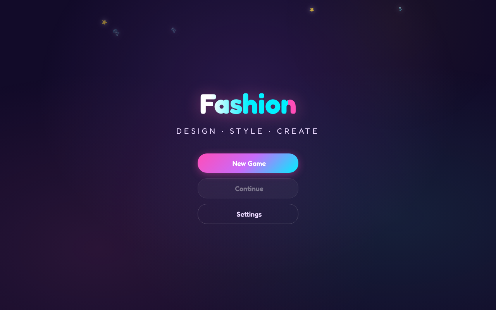
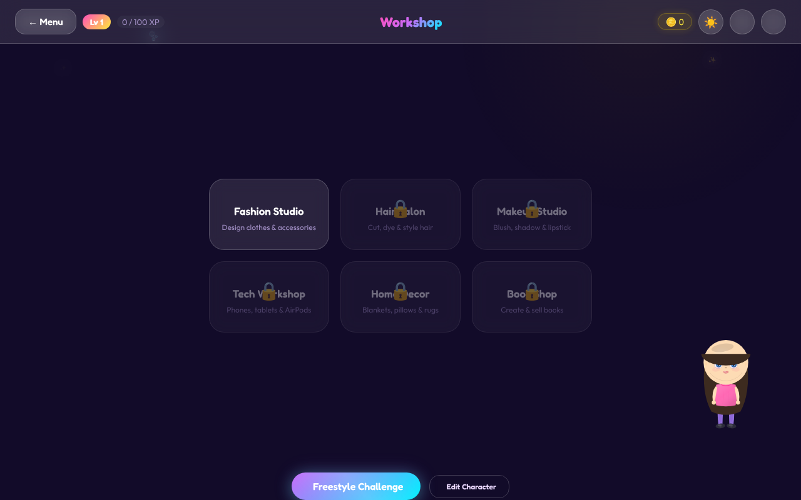

<h1 align="center">Fashion City</h1>
<p align="center"><b>A browser-based design and style game: create a character, design clothes, style hair and makeup, and level up.</b></p>
<p align="center">


</p>

<p align="center">


</p>

Fashion City is a self-contained web game. Make your own character, then work through a set of creative studios where you design outfits and accessories, cut and dye hair, and apply makeup. You earn XP and coins and level up as you create, unlocking new studios along the way.

## Features

- **Character creator:** face shape, skin tone, hair style and color, eye shape and color, plus a random option.
- **Creative studios:** Fashion Studio, Hair Salon, Makeup Studio, Tech Workshop, Home Decor and a Book Shop. Studios unlock as you level up.
- **Progression:** levels, XP and coins, with new game, continue and settings menus and a freestyle challenge.
- **Zero dependencies:** plain HTML, CSS and JavaScript. No install, no build step.

## Play

```sh
git clone https://github.com/Ethan-da-Tech-Wizard/Fashion.git
cd Fashion
open index.html   # or double-click it in your file manager
```

Or serve it locally:

```sh
python3 -m http.server 8000
```

## Roadmap

The next big step is an open-world 2D RPG city built around the current menu-driven game. See [open_world_roadmap.md](open_world_roadmap.md) for the plan.

## Project layout

| Path | Purpose |
|---|---|
| `index.html` | Game page and menus |
| `style.css` | Visual design |
| `js/` | Game logic |
| `open_world_roadmap.md` | Open world design notes |
| `docs/` | Screenshots |

## License

Released under the [MIT License](LICENSE).
